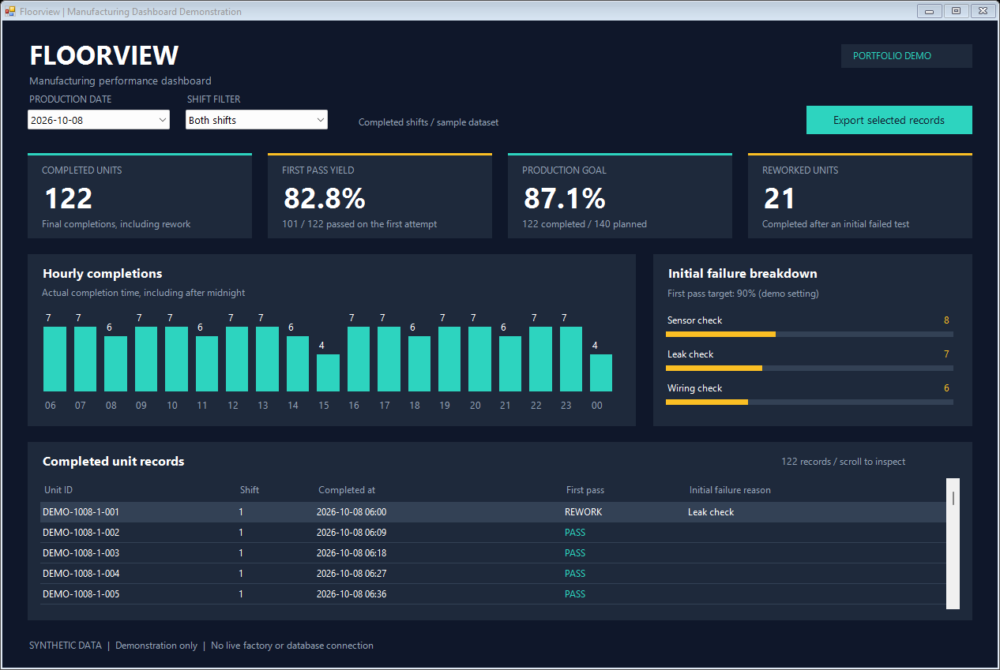
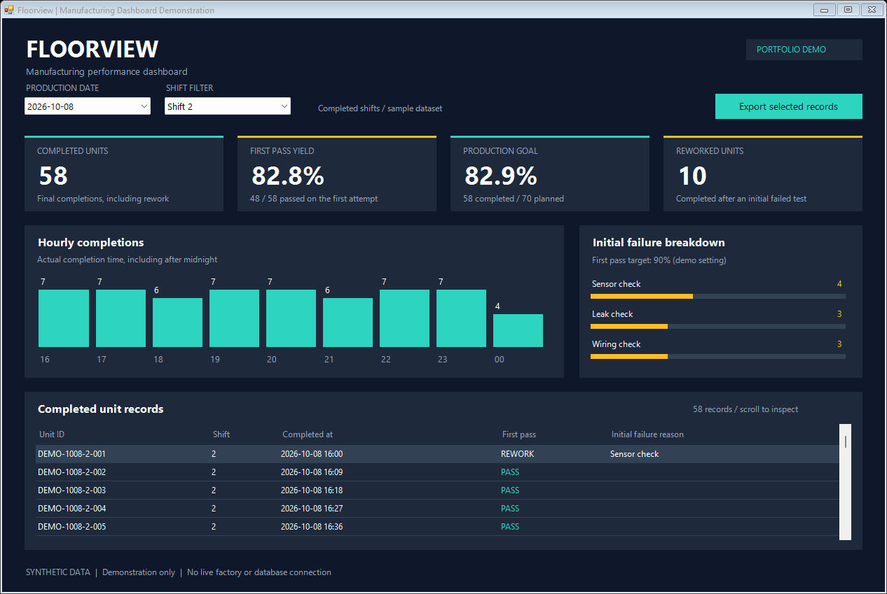

# Floorview | C# Manufacturing Dashboard

A small C# WinForms application for an Upwork portfolio. All records are generated
sample data. It is not an employer project and has no live database connection.
The demonstration was prepared with AI assistance; review and understand the code
before presenting or discussing it with a client.



## Features

- Date and shift filtering across 354 synthetic production records.
- Completed-unit counts, first-pass yield, goal progress, and rework totals.
- Hourly output charts and initial-failure breakdowns.
- A scrollable unit table and CSV export of the selected records.
- Production-date handling for second-shift completions after midnight.
- A separate SQL Server reporting example.



## Open the demonstration

1. Clone this repository or download and extract its ZIP on a Windows computer.
2. Run `Build.ps1`, then open `FloorviewDemo.exe`. A prebuilt executable is also
   included in the original Upwork portfolio package. The application requires
   the installed Windows .NET Framework.
3. Switch between the three production dates and the Both shifts / Shift 1 / Shift 2 filters.
4. Inspect the four metrics, hourly chart, failure breakdown, and scrollable unit records.
5. Select **Export selected records** to save the current selection to CSV.

The executable does not access the network, require credentials, install software,
or access employer data. It writes a file only when you choose an export destination.
Windows may display a warning for this unsigned sample executable. The source and
build instructions are included so you can build it yourself instead.

## Files

- `Program.cs`: complete C# source: sample data, selection, metrics, UI, and CSV export.
- `ManufacturingDashboard.csproj`: Visual Studio project targeting .NET Framework 4.8.
- `Build.ps1`: local compiler build, with no package downloads.
- `FloorviewDemo.exe`: generated locally by the build script (not committed).
- `SampleData.csv`: all 354 generated records, across three production dates.
- `DemoQueries.sql`: independent SQL Server sample data and reporting queries.
- `Dashboard-Overview.png`: screenshot of both shifts on October 8.
- `Dashboard-Shift2.png`: screenshot of second shift on October 8.
- `UPWORK_PROJECT.md`: portfolio project description and upload notes.

## Build and check

From PowerShell in the extracted directory:

```powershell
.\Build.ps1
.\FloorviewDemo.exe --self-test | Out-String
```

The build script uses the local .NET Framework compiler. Visual Studio users can
instead open the `.csproj` with the .NET Framework 4.8 development tools installed.

Capture screenshots without opening an interactive window:

```powershell
.\FloorviewDemo.exe --capture "$PWD\Dashboard-Overview.png" 0 | Out-String
.\FloorviewDemo.exe --capture "$PWD\Dashboard-Shift2.png" 2 | Out-String
```

## Metric definitions

- **Completed units:** every sample row represents one final completion. Reworked
  units are included because they eventually completed.
- **First pass yield:** units that passed the initial test divided by all selected
  completed units. Reworked units count in the denominator, not the numerator.
- **Production goal:** completions divided by 70 planned units per selected shift.
  The 70-unit goal and 90% quality target are demonstration settings.
- **Reworked units:** completed units that failed their initial test.
- **Hourly completions:** buckets use actual completion timestamps. A record can
  complete after midnight while retaining the previous day's production date.

Default selection (October 8 / Both shifts): **122 completions, 101 first-pass,
21 reworked, 82.8% FPY, 87.1% of goal**. Shift 2: **58 completions, 48 first-pass,
10 reworked, 82.8% FPY, 82.9% of goal**.

## Validation and limitations

The source compiled successfully. Nine automatic checks cover record counts and
unique identifiers, date/shift filtering, yield calculations, midnight handling,
empty selections, selected-row exports, and CSV quoting. Both screenshots were
rendered from the application and visually reviewed.

`DemoQueries.sql` has not been executed against SQL Server in this environment.
The application generates data in memory; it does not import the CSV, authenticate
users, query a database, stream real-time data, or generate Excel workbooks. Dates,
shift schedules, targets, and failure reasons are deliberately limited sample
settings. Do not claim measured client savings or production deployment for this demo.

## Review before adding it to your profile

- Run both shift filters and try an export.
- Explain the FPY calculation in your own words.
- Find the code that retains production date after midnight.
- Make a small change yourself, such as adding a fourth sample date or a new metric.
- Upload the screenshot and the project description once you are comfortable
  explaining the implementation. Share the source with prospective clients as needed.

Possible next improvement: replace the sample generator with a SQL Server data
repository and parameterized date/shift queries. That would require a separate
database setup and validation.

## More portfolio work

- [SQL-to-Excel reporting automation](sql-to-excel-reporting/): a C# exporter
  with a reusable Excel template, date and shift filters, parameterized SQL
  extraction, and a tested sample-data workflow.
