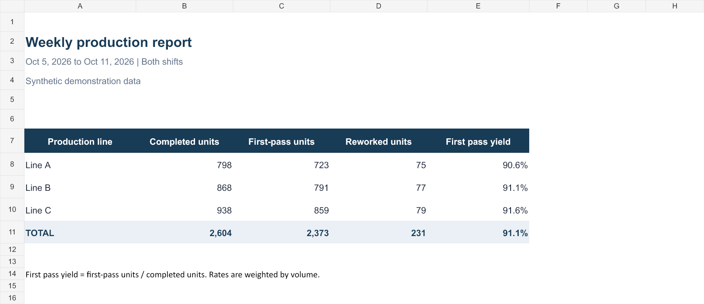
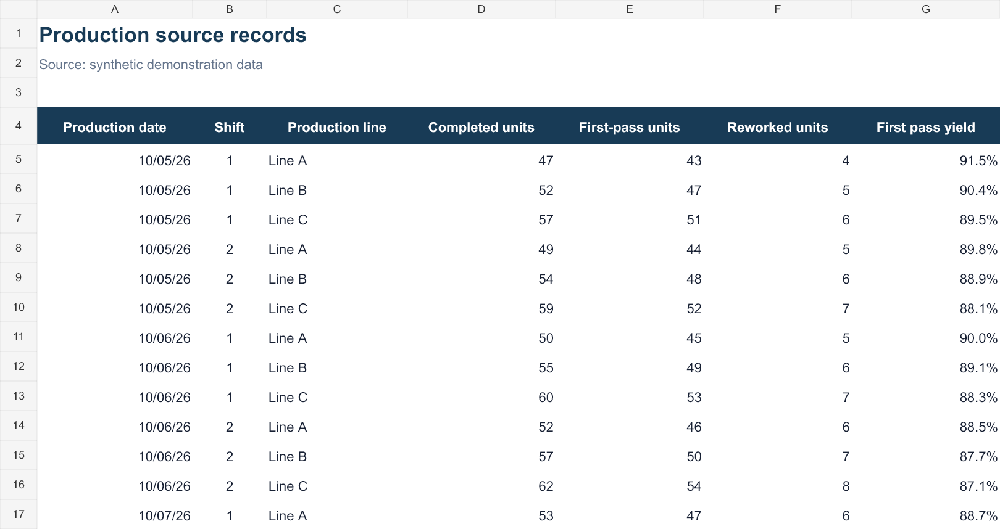

# SQL-to-Excel Production Reporting

A C# command-line reporting demonstration that produces a formatted Excel
workbook from production records. It includes a runnable sample-data mode and a
SQL Server mode with parameterized date and shift filters. The source and Excel
template were prepared with AI assistance. All included records are synthetic.



## What it demonstrates

- Extracting records through a parameterized SQL query.
- Filtering a report by production date range and shift.
- Rejecting duplicate keys, invalid shifts and inconsistent counts.
- Populating an Excel template without requiring Microsoft Excel or third-party
  .NET packages on the computer running the exporter.
- Producing a line summary and a detailed source sheet with live Excel formulas.
- Computing first-pass yield from aggregate counts rather than averaging rates.



## Run the sample on Windows

From PowerShell in this folder:

```powershell
.\Build.ps1
.\ReportExport.exe --self-test
.\ReportExport.exe --output .\Weekly_Report.xlsx
.\ReportExport.exe --from 2026-10-05 --to 2026-10-07 --shift 2 --output .\Shift2_Report.xlsx
```

Open `Weekly_Report.xlsx` in Excel to inspect the Summary and Detail sheets.
Changing a completed-unit or first-pass count in Detail updates the report's
formulas. To report a new date range from the source, rerun the exporter; the
workbook is a generated report, not a live database connection.

The default sample has 42 records from October 5–11, 2026: **2,604 completed units,
2,373 first-pass units and 231 reworked units**, with **91.1% first-pass yield**.
The date range is inclusive; shift 0 means both shifts. A date range with no
records produces zero counts and a blank yield instead of a divide-by-zero error.

## SQL Server mode

`DemoSchema.sql` documents and creates the expected sample table. Run it only in
a dedicated demo database you choose. It does not drop an existing table.

Set `SQL_REPORT_CONNECTION` locally to your own connection string, then run:

```powershell
.\ReportExport.exe --sql --from 2026-10-05 --to 2026-10-11 --shift 0 --output .\Sql_Report.xlsx
```

The program reads `dbo.ProductionDaily` through `ReportQuery.sql` and never writes
to the database. Date and shift parameters use explicit SQL types. Connection
strings are supplied through the environment and are not stored in this repo.

This database path has **not been tested against a running SQL Server instance**.
The filter query was exercised against an equivalent local SQLite schema, and
the sample-data export was tested end to end. You must adapt the schema/query
and test your own SQL Server connection before using the SQL mode with real data.

## Files

- `ReportExport.cs` and `Reporting.csproj`: C# source and Visual Studio project.
- `Build.ps1`: builds with the local .NET Framework compiler.
- `ReportTemplate.xlsx`: reusable styled workbook template.
- `Weekly_Report.xlsx`: completed sample workbook.
- `SampleData.json`: synthetic records, for inspection and independent checks.
- `ReportQuery.sql`: parameterized extraction query.
- `DemoSchema.sql`: SQL Server demonstration schema and seed data.
- `UPWORK_PROJECT.md`: title, description and upload checklist.
- `Report-Overview.png` and `Report-Detail.png`: previews of the completed workbook.

The exporter fills the template's first two sheets (Summary and Detail),
preserves their formatting, writes cached numeric results, and retains formulas
for recalculation. Do not change the template's sheet order or header-row layout
without updating the exporter. The exported workbook has no macros or external
data links. The compiled executable is created locally and is not committed.

## Validation

Checked compilation, source counts, duplicate rejection, date/shift query
boundaries, empty selections, XLSX package structure, cached summary results,
formula recalculation after changing a source value, and both report previews.
Native Microsoft Excel behavior was not tested in this environment.

## Optional scheduled use

After testing your database setup, Windows Task Scheduler can run the executable
with explicit dates and an output destination. The project does not install a
scheduled task or send reports automatically.
